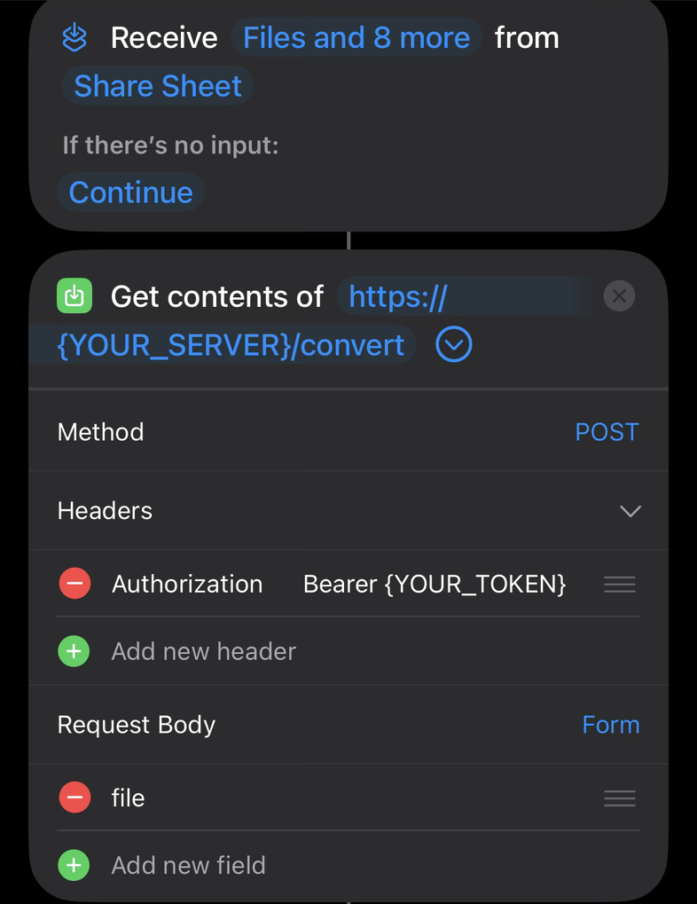
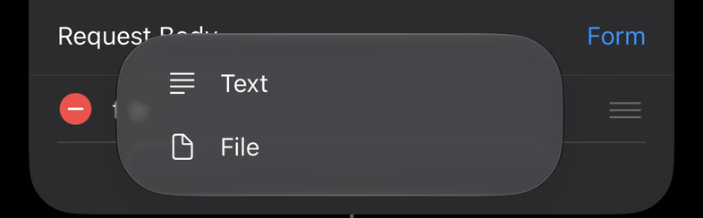
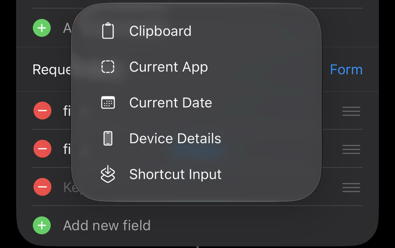
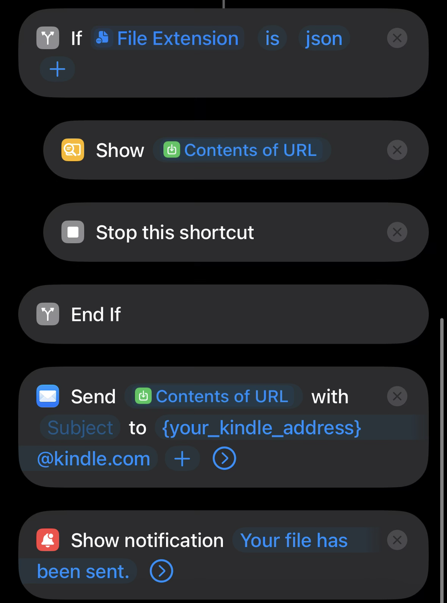
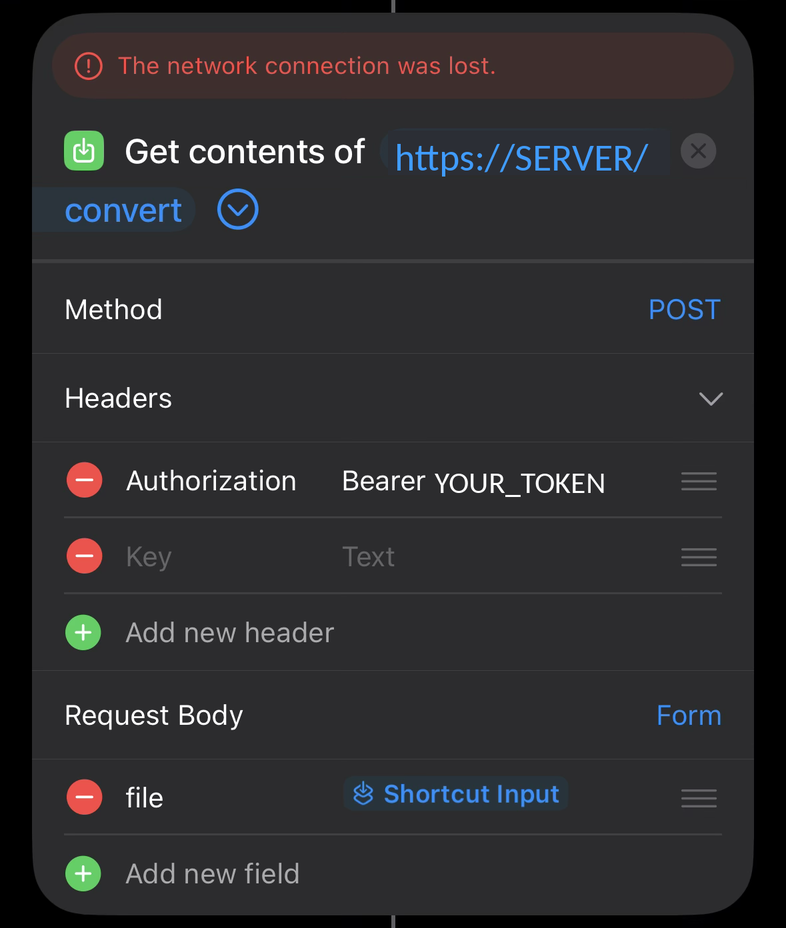
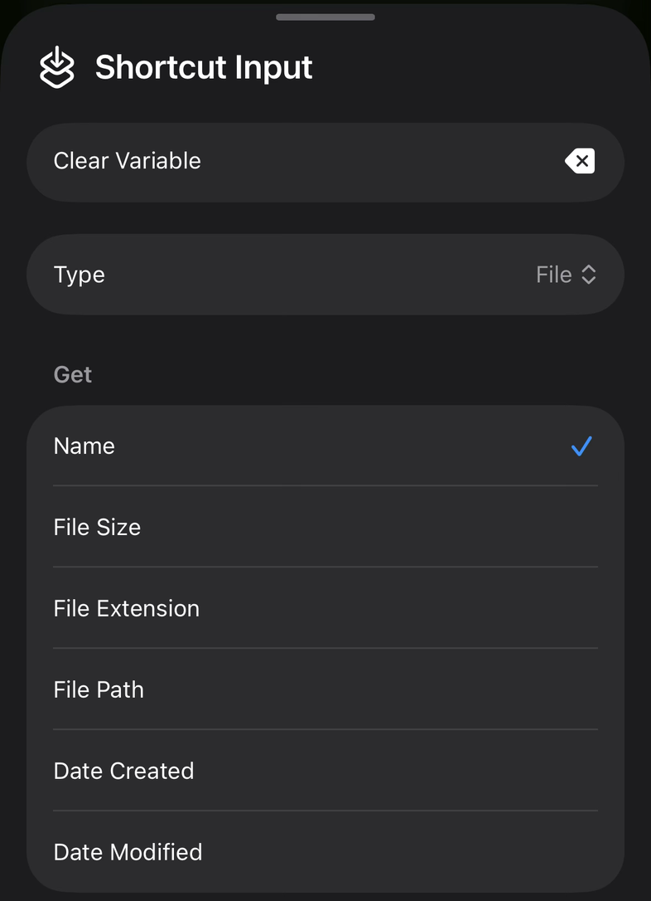

# kindlepost

Send ebooks from an iPhone to a Kindle from the share sheet.

Every Kindle has its own email address, and Amazon delivers anything mailed to it from an approved sender to that Kindle. Amazon only accepts some formats, and books often arrive with the wrong title, the wrong author, or no cover. kindlepost is a small server that fixes the file before it is mailed: it converts it to a format Amazon accepts, looks up the correct title, author, series and cover, and hands the result back to the phone. An iOS Shortcut then emails it from the phone's Mail app.

The server never sends email and stores no email passwords. It keeps no copies of books; each upload is deleted once the converted file is returned.

## How it works

1. In the Files app, Safari, Mail or any other app, tap **Share → Send to Kindle** on an ebook.
2. The **Send to Kindle** Shortcut uploads the file to kindlepost.
3. kindlepost converts the file with [Calibre](https://calibre-ebook.com) (an open-source ebook converter), fills in the book's details, and returns the new file.
4. The Shortcut emails the file to your `@kindle.com` address.
5. The book appears in the Kindle library a few minutes later.

kindlepost runs in [Docker](https://www.docker.com) on any computer that stays on: a Mac, a Linux box, a NAS, or a cloud server. The phone reaches it over [Tailscale](https://tailscale.com), a free private network between your own devices, so the server is never exposed to the internet.

## What you need

- An iPhone or iPad with the Shortcuts app
- A Kindle or the Kindle app, and access to the Amazon account it is registered to
- An email account set up in the iPhone's Mail app
- A computer that can run Docker and stays on when you want to send books
- A free Tailscale account

## Setup

### 1. Find your Kindle address and approve your email

Amazon's [Send to Kindle by email](https://www.amazon.com/sendtokindle/email) page covers this step in full, including the file types and sizes Amazon accepts.

1. Go to amazon.com → **Account & Lists → Content Library → Preferences** (on some Amazon sites: **Manage Your Content and Devices → Preferences**).
2. Under **Personal Document Settings**, find your Kindle's email address. It ends in `@kindle.com`.
3. On the same page, under **Approved Personal Document E-mail List**, add the email address the iPhone's Mail app sends from. Amazon ignores mail from any other address.

### 2. Run the server

**On a Mac:**

1. Install [OrbStack](https://orbstack.dev) or [Docker Desktop](https://www.docker.com/products/docker-desktop/) and open it once.
2. Run:
   ```sh
   git clone https://github.com/tahazar/kindlepost.git
   cd kindlepost
   ./bootstrap-mac.sh
   ```
   The first run creates a `.env` settings file with a random access token, builds the server (a few minutes, mostly downloading Calibre), starts it, and prints its addresses. Running the script again rebuilds and restarts the server.
3. In OrbStack or Docker Desktop settings, turn on starting at login. In **System Settings → Energy**, stop the Mac from sleeping, or the phone can't reach the server.

**On any other computer with Docker:**

```sh
git clone https://github.com/tahazar/kindlepost.git
cd kindlepost
cp .env.example .env
sed -i "s/^API_TOKEN=.*/API_TOKEN=$(openssl rand -hex 24)/" .env
docker compose up -d --build
```

**Check it:** `curl localhost:8090/health` should print `{"ok":true}`.

**Get the access token** (needed for the Shortcut):

```sh
docker compose exec kindlepost printenv API_TOKEN
```

Anyone with this token and network access to the server can use it to convert files, so keep it out of screenshots, chats and shared notes. To replace it, put a new value in `.env` (`openssl rand -hex 24`), run `docker compose up -d --force-recreate`, and paste the new token into the Shortcut.

### 3. Reach the server from your phone

1. Install Tailscale on the server computer and on the iPhone, and sign in to the same account on both.
2. On the server, run:
   ```sh
   tailscale serve --bg 8090
   ```
   The first time, Tailscale may open its admin page and ask you to enable HTTPS certificates; enable them.
3. Run `tailscale serve status`. It shows an address like `https://my-mac.tailnet-name.ts.net`. This is the server's address from the phone; the rest of this guide calls it `SERVER`.
4. With Tailscale connected on the iPhone, open `https://SERVER/health` in Safari. It should show `{"ok":true}`.

If something else already uses `tailscale serve` on this computer, give kindlepost its own HTTPS port instead: `tailscale serve --bg --https=8443 8090`, and use `https://SERVER:8443` everywhere below.

### 4. Build the Shortcut

In the Shortcuts app, create a new Shortcut named **Send to Kindle**:

1. Tap the **ⓘ** button, turn on **Show in Share Sheet**, and set the accepted input to **Files**.
2. Add **Get Contents of URL**. Tap the arrow next to the URL to show its options:
   - URL: `https://SERVER/convert`
   - Method: **POST**
   - Headers: tap **Add new header**. Key `Authorization`, value `Bearer ` followed by the token. Paste the token; a typo or trailing space gives a "bad token" error. Leave no empty header rows.
   - Request Body: **Form**. Tap **Add new field** and choose **File**. Tap **Choose** and pick **Shortcut Input**, then type `file` as the key. The finished row shows only the key, `file`.

   

   
   
3. Add **Get Details of Files**, set to **File Extension** of **Contents of URL**.
4. Add **If** *File Extension* **is** `json`. Inside it, add **Show Result** with **Contents of URL**, then **Stop This Shortcut**. Errors come back as JSON, so this shows the error instead of emailing it.
5. After **End If**, add **Send Email**:
   - Message: the **Contents of URL** variable. This is the file kindlepost returned. **Shortcut Input** would email the original, unconverted book.
   - Recipient: your `@kindle.com` address
   - From: the address you approved in step 1
   - Turn **Show Compose Sheet** off to send without a confirmation screen. Leave it on the first time to check that the book is attached and its name has changed to `Title - Author`.
6. Optionally add **Show Notification**.

   

### 5. Send a book

With Tailscale connected on the phone, open a book in Files (or Safari downloads, Mail attachments, and so on) and tap **Share → Send to Kindle**. Files stored in OneDrive, iCloud Drive or Dropbox must be downloaded to the phone first.

## What happens to each file type

| File | Result |
|---|---|
| EPUB | Rebuilt with Calibre, which fixes most books Amazon would otherwise reject with an "E999" error |
| PDF | Converted to EPUB so the text adjusts to the Kindle's screen and font size. If conversion fails, as with scanned PDFs, the original PDF is sent. |
| DOCX, TXT, RTF, HTML | Sent as they are; Amazon converts these itself |
| MOBI, AZW, AZW3, FB2, LIT, ODT, CBZ, CBR, Markdown, and other formats Calibre reads | Converted to EPUB |

Plain novels convert well from PDF. PDFs with columns, tables, footnotes or complex layouts can come out jumbled; set `PDF_TO_EPUB=0` to always send PDFs unchanged.

Amazon rejects emails over 50 MB, so kindlepost refuses results over 48 MB. Send larger books through [amazon.com/sendtokindle](https://www.amazon.com/sendtokindle).

## Book details lookup

For EPUB, PDF, DOCX and RTF results, kindlepost searches online book databases (Amazon, Google Books and others, through Calibre) and writes the correct title, authors, series and number, ISBN, Amazon ASIN and, for EPUBs, the cover into the file. The emailed file is named `Title - Author`.

- The search uses the `title` and `author` sent with the request if there are any, then the details already inside the book, then the file name. File names such as `Brown, Dan - Da Vinci Code.pdf` and `(Red Rising Saga) Pierce Brown - Golden Son.epub` are understood.
- A result is applied only when its title and author closely match the search. Otherwise the book is sent with its original details.
- The search stops after 20 seconds (`LOOKUP_TIMEOUT`) so the Shortcut doesn't time out.
- A book emailed to a Kindle is always a personal document, even with an ASIN, so store features such as Whispersync and X-Ray are not available for it.
- `docker compose logs | grep lookup` shows what each book matched.

To set a title and author yourself, add two **Ask for Input** actions before **Get Contents of URL** and send their answers as Text form fields named `title` and `author`. These always override the lookup.

## Settings

Settings live in `.env` in the kindlepost folder. After changing one, run `docker compose up -d --force-recreate`.

| Setting | Default | Meaning |
|---|---|---|
| `API_TOKEN` | random | Token the Shortcut must send. Required. |
| `HOST_PORT` | `8090` | Port the server listens on. Change it if another program uses 8090, and use the new port in the `tailscale serve` command. |
| `NORMALIZE_EPUB` | `1` | `1` rebuilds every EPUB with Calibre; `0` sends EPUBs unchanged unless a title or author is set. |
| `PDF_TO_EPUB` | `1` | `1` converts PDFs to EPUB; `0` sends PDFs unchanged. |
| `METADATA_LOOKUP` | `1` | `1` looks up book details; `0` turns the lookup off. |
| `LOOKUP_TIMEOUT` | `20` | Seconds the lookup may take. |

## Other ways to send

- **Web page:** `https://SERVER/` has an upload form that converts a file and downloads the result.
- **Links:** duplicate the Shortcut, set accepted input to **URLs**, change the URL to `https://SERVER/convert-url`, and replace the `file` field with a Text field `url` set to **Shortcut Input**. Sharing a direct download link then sends that book.
- **Command line:**
  ```sh
  curl -o book.epub -H "Authorization: Bearer $TOKEN" -F file=@book.mobi https://SERVER/convert
  ```

## API

All requests except `/` and `/health` need the header `Authorization: Bearer <token>`.

| Request | Fields | Response |
|---|---|---|
| `POST /convert` | `file` (file, required); `title`, `author`, `lookup` (text, optional) | The converted file |
| `POST /convert-url` | `url` (text, required); `title`, `author`, `lookup` (text, optional) | The converted file |
| `GET /health` | | `{"ok":true}` when Calibre is installed |
| `GET /` | | Upload page |

`lookup` set to `0` skips the book details lookup for that request; `1` forces it on.

Errors return JSON such as `{"detail":"bad token"}` with one of these status codes:

| Code | Cause |
|---|---|
| 400 | Empty file, or a link that is not `http(s)` or could not be downloaded |
| 401 | Missing or wrong token |
| 413 | Result over 48 MB |
| 415 | File type Calibre can't read |
| 422 | Calibre could not convert the file |

## Troubleshooting

| Problem | Fix |
|---|---|
| Shortcut shows "The network connection was lost" | Delete any empty header rows in **Get Contents of URL** (first screenshot below). Check that Tailscale is connected on the phone and the server computer is awake. Download cloud files to the phone before sharing them. |
| `{"detail":"bad token"}` | The token in the Shortcut doesn't match the server's. Copy it again with `docker compose exec kindlepost printenv API_TOKEN` and paste it after `Bearer `. If `.env` was edited, run `docker compose up -d --force-recreate`. |
| `Expected UploadFile, received: <class 'str'>` | The form field `file` is a Text field, or **Name** is ticked on the Shortcut Input variable. Recreate it as a **File** field (step 4). If the field shows **Shortcut Input**, tap it and untick everything under **Get** (second screenshot below). |
| Email arrives without an attachment | In **Send Email**, tap the **Contents of URL** variable, set its type to **File**, and untick everything under **Get**. |
| Books arrive with their original file name, title and format (PDFs stay PDFs) | **Send Email** is attaching **Shortcut Input**, the book as shared. Replace it with **Contents of URL**. |
| Email sent, but the book never appears | The sending address isn't on Amazon's approved list, or the book is over 50 MB. Amazon emails the sender when it rejects a document. |
| The phone shows a different website at the server's address | Another program is listening on the same port. On the server, run `lsof -nP -iTCP:8090 -sTCP:LISTEN`. Set a free port as `HOST_PORT` in `.env`, run `docker compose up -d --force-recreate`, and point `tailscale serve` at the new port. |
| Wrong title, author or cover | Send the book again with `title` and `author` set (see **Book details lookup**), or with `lookup` set to `0`. |
| Anything else | `docker compose logs -f` shows each request and lookup as it happens. |




Left: an empty **Key / Text** header row under **Authorization**, which causes "The network connection was lost". Right: **Name** ticked under **Get**, which sends only the file name.

## Updating and stopping

```sh
git pull
docker compose up -d --build   # update and restart
docker compose down            # stop
```
